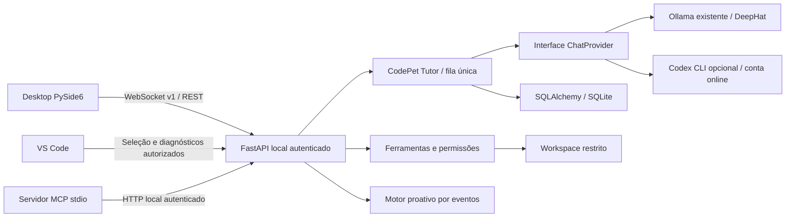

# Arquitetura

## Decisões

O processo desktop usa Qt Widgets e Qt Network/WebSockets. Não importa o provider nem chama um LLM; a configuração é compartilhada, mas a inferência, os arquivos e a persistência ficam no backend. Eventos de rede e animações usam o event loop Qt. Nenhum `requests`, subprocesso ou inferência bloqueante é executado na thread gráfica.



- `backend/app/core`: configuração local, segredo e fronteira ASGI de acesso.
- `schemas`: contratos Pydantic v1, campos extras rejeitados e tamanhos limitados.
- `api`: o transporte está em `main.py` nesta versão pequena; extração em routers quando justificar.
- `agents` / `learning`: preparação de contexto, modos pedagógicos e orquestração de geração.
- `skills`: catálogo local de instruções `SKILL.md`; Ponytail, Caveman e Graphify são padrão, com escolha manual opcional e limite de contexto.
- `llm`: protocolo `ChatProvider`, implementação HTTP Ollama, adaptador opt-in para o Codex CLI e `HybridProvider`, que transmite a resposta local e uma segunda opinião online em sequência.
- `context`: caminhos seguros e ferramentas de código/Git/testes.
- `memory`: persistência SQLAlchemy síncrona executada via `asyncio.to_thread`; migrações Alembic separadas do startup.
- `permissions`: hash da ação, TTL e aprovação de uso único.
- `proactive`: estado limitado a 512 fingerprints; debounce de 2 s, janela de recorrência de 10 min e cooldown de 120 s por projeto.
- `mcp`: adaptador de servidor oficial; não concede permissões e não inicia servidores externos.
- `apps/desktop`: máquina de estados, renderização, transporte desacoplado e síntese local assíncrona via `espeak-ng`.
- `apps/vscode-extension`: coleta opt-in, segredo nativo e comandos explícitos.

Captura de tela opcional usa `grim` somente após habilitação explícita; terminal é recebido somente por observação explícita do cliente. Não há provider direto da OpenAI API. A saída de voz local vive somente no desktop. O adaptador Codex CLI chama a conta autenticada do usuário quando selecionado, sem usar o servidor MCP do CodePet como transporte.

## Contrato de chat

`ws://127.0.0.1:8765/v1/chat`, sem `Origin` de navegador. O primeiro frame deve chegar em cinco segundos:

```json
{"v":1,"type":"auth","token":"TOKEN_LOCAL"}
```

Após `ready`, envie `ChatRequest` com `request_id` e `session` UUID, `project`, `prompt`, `mode`, `use_editor` e, opcionalmente, `skill` (`auto` por padrão, um ID listado em `GET /v1/skills` ou `null` para desativar). O backend emite `queued`, `state` (incluindo os IDs das skills ativas), zero ou mais `token`, então `done`, `cancelled` ou `error`. Todos incluem `v:1` e `request_id`. Cancelamento: `{"v":1,"type":"cancel"}`. IDs correlacionam respostas, não são chaves de idempotência persistentes.

Até oito conexões. Uma geração por conexão; uma inferência por backend com semáforo. Desconectar cancela a geração/espera e fecha a leitura HTTP Ollama. A ausência do marcador `done` da API Ollama é falha, não sucesso. Não se carrega um segundo modelo, não se faz pull e não se executa outro servidor Ollama.

## Contexto e retenção

A sessão organiza as conversas; o projeto limita todos os registros. Notas são recuperadas por relevância lexical e recência, evitando que conversas ocultem preferências. O prompt é truncado por orçamento textual e o Ollama recebe limites de contexto/saída. Embeddings reais continuam fora do núcleo para não exigir outro modelo local.

Turnos completos são gravados numa única transação. Cancelamentos durante a geração não guardam respostas parciais. Há uma pequena janela depois de concluir a geração em que a gravação já iniciada em uma thread pode terminar mesmo se o transporte for desconectado.

Editor, memória e diagnósticos entram como dados não confiáveis. Não há interpretação automática de instruções nem chamada de ferramentas pelo texto do LLM. A proatividade produz um convite baseado num diagnóstico observado três vezes; não confirma um bug nem invoca o LLM automaticamente.

## Wayland

A janela usa `startSystemMove()` para solicitar arraste ao compositor. A caminhada ocorre dentro da janela; não foi implementado layer-shell. No Hyprland 0.56.2 do host, um adaptador usa `hyprctl` para flutuar, redimensionar, posicionar e fixar a janela nos workspaces do mesmo monitor. A máscara segue a silhueta do SVG; antes de cada mudança de máscara, o Qt repinta toda a superfície translúcida para não deixar pixels antigos. Posicionamento e clique através exigem nova validação em outros compositores.

A documentação do [Qt sobre janelas](https://doc.qt.io/qt-6/application-windows.html) explica por que XDG Shell não oferece posicionamento manual global. Protocolos de layer-shell ou integração específica com o compositor devem ser avaliados sem prometer portabilidade automática.

## Referências

- [Ollama HTTP API e streaming](https://github.com/ollama/ollama/blob/main/docs/api.md).
- [SDK MCP oficial](https://github.com/modelcontextprotocol/python-sdk) — dependência limitada à série 1.x, `FastMCP`.
- [VS Code API](https://code.visualstudio.com/api/references/vscode-api) — diagnósticos, eventos e SecretStorage.
- [VS Code 1.101](https://code.visualstudio.com/updates/v1_101) — Extension Host com Node 22, necessário para WebSocket nativo.
